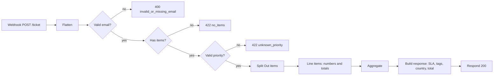

# Workflow 02: Ticket Normalizer

Takes messy, nested support-ticket JSON and returns clean, validated, enriched JSON. Built to practice the n8n data model: items, expressions, branching, Split Out, Aggregate and the Code node.

## Flow



## Input (messy)

- Priority has stray whitespace and mixed case (`"HIGH "`)
- Email is mixed case
- Names are padded with spaces
- `qty` and `price` are strings
- `tags` is one comma-separated string

## Output (clean)

```json
{
  "ticket_id": "T-1001",
  "created_at": "2026-11-20T09:15:00Z",
  "priority": "high",
  "sla_hours": 4,
  "customer": {
    "name": "Nimal Perera",
    "email": "nimal@example.com",
    "country_code": "LK",
    "country_name": "Sri Lanka",
    "region": "Asia"
  },
  "subject": "Refund not received",
  "tags": ["billing", "urgent", "refund"],
  "items": [
    { "sku": "A-100", "qty": 2, "unit_price": 1500.5, "line_total": 3001 },
    { "sku": "B-200", "qty": 1, "unit_price": 799, "line_total": 799 }
  ],
  "order_total": 3800
}
```

## Error responses

| Status | Body                                   | When                                                                      |
| ------ | -------------------------------------- | ------------------------------------------------------------------------- |
| 400    | `{"error":"invalid_or_missing_email"}` | Email missing or not a valid format                                       |
| 422    | `{"error":"no_items"}`                 | `items` list is empty                                                     |
| 422    | `{"error":"unknown_priority"}`         | Priority is not high, medium or low                                       |
| 422    | n8n parse error                        | Request body is not valid JSON (rejected by n8n before the workflow runs) |

## SLA rules

| Priority | SLA hours |
| -------- | --------- |
| high     | 4         |
| medium   | 24        |
| low      | 72        |

## Test results (10 payloads, production URL)

| File | Case                   | Result                                  |
| ---- | ---------------------- | --------------------------------------- |
| 01   | Good, messy values     | 200, clean output, total 3800           |
| 02   | Already clean          | 200                                     |
| 03   | Medium priority        | 200, SLA 24                             |
| 04   | Low priority           | 200, SLA 72                             |
| 05   | Missing email          | 400                                     |
| 06   | Bad email              | 400                                     |
| 07   | Empty items            | 422 `no_items`                          |
| 08   | Unknown priority       | 422 `unknown_priority`                  |
| 09   | Unknown country (`ZZ`) | 200, country name and region are `null` |
| 10   | Malformed JSON         | 422 from n8n (workflow never runs)      |

Raw output: [`ticket-test-run.txt`](ticket-test-run.txt). Run the tests with the loop in the main README.

## Design decisions

- **Validate before transforming.** Cheap checks (email, items, priority) run first so bad input fails fast with a clear status code.
- **Guard the empty list.** Split Out on an empty list produces zero items and the workflow would end without replying, so `Has items?` catches it first.
- **Read ticket details from `Flatten` by name.** Split Out and Aggregate drop the other fields, so the final Code node reads them back with `$('Flatten')`.
- **Local country lookup table instead of an API.** The public REST Countries v3.1 endpoint I first used was shut down (the replacement needs an API key). The `Country lookup` HTTP node is kept but disabled, and a small lookup table in the Code node replaces it. Unknown codes return `null` instead of failing.
- **Numbers converted explicitly** with `Number()`, because webhook data arrives as strings and string arithmetic gives wrong results.

## Limitations and next steps

- Webhook has no authentication yet (planned for Day 6).
- The country table has 8 countries; unknown codes return `null`.
- Possible upgrade: move to the REST Countries v5 API with the key stored as an n8n credential.
- No duplicate-ticket detection yet (idempotency is planned for Day 6).
